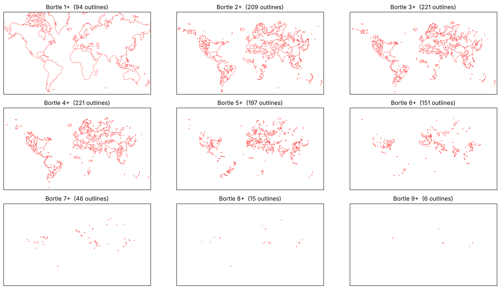
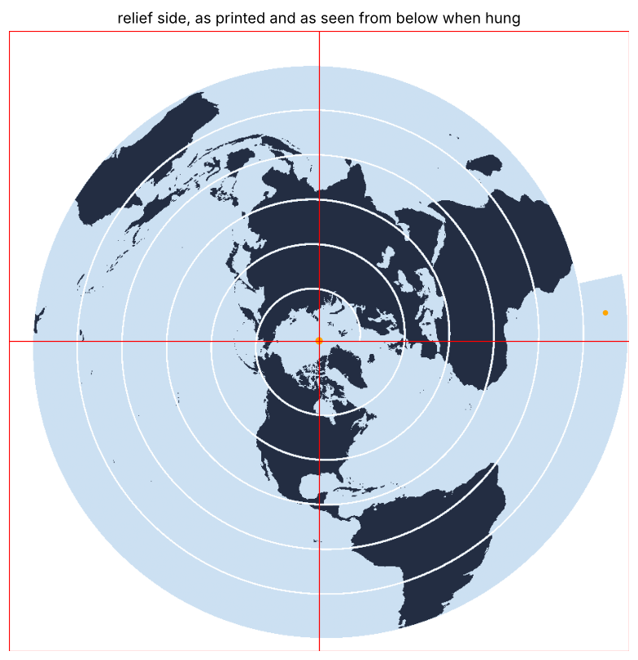
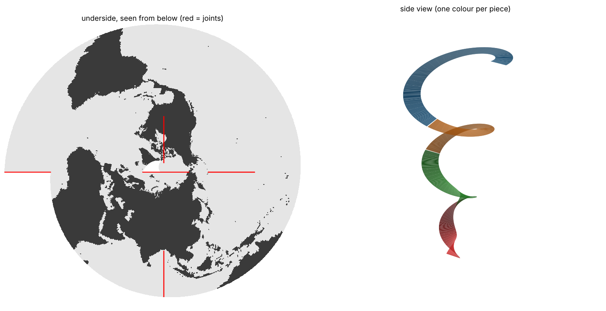
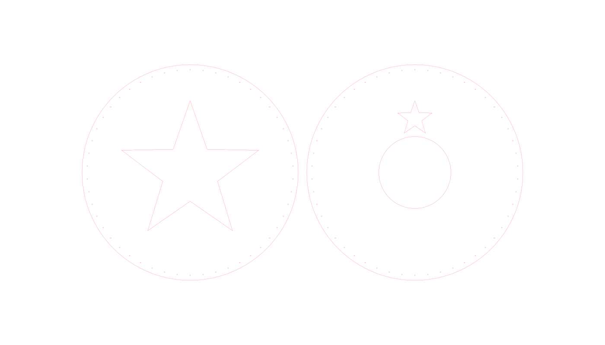

# Maps to make

Python notebooks that turn world data into files for a laser cutter or a 3D printer. Each project starts from a map or a drawing and ends with cut files (SVG, PDF) or print files (STL) that are ready to load.

| Project | Makes | Machine | Output |
|---|---|---|---|
| [Bortle layers](#1-bortle-layers) | Stacked sheets showing world light pollution | Laser cutter | SVG + PDF |
| [Spiral map](#2-spiral-map) | A hanging spiral strip carrying a world map | 3D printer, 2 colours | STL |
| [Disc hole ring](#3-disc-hole-ring) | Discs with a ring of crochet holes, packed on sheets | Laser cutter | SVG |

All code is documented with Doxygen-style docstrings (`"""!` with `@brief`, `@param`, `@return`), see [Documentation](#documentation).

---

## Repository layout

```
.
├── bortle_layers/
│   └── bortle_layers_world.ipynb
├── spiral_map/
│   └── spiral_map.ipynb          # flat disc and conical spiral, pick with MODE
├── disc_hole_ring/
│   └── disc_hole_ring.ipynb
├── data/
│   └── ne_50m_land.geojson       # Natural Earth land polygons (public domain)
├── docs/images/                  # previews used in this README
├── LICENSE
├── requirements.txt
└── README.md
```

## Setup

```bash
git clone https://github.com/NGC-1097/maps-to-make.git
cd maps-to-make
python -m venv .venv && source .venv/bin/activate
pip install -r requirements.txt
jupyter lab
```

Open a notebook from its own folder and run the cells top to bottom. Generated files are written next to the notebook and are ignored by git.

---

## 1. Bortle layers



### What it does

It downloads the 2025 world light pollution map from [lightpollutionmap.app](https://lightpollutionmap.app), sorts every pixel into a [Bortle level](https://en.wikipedia.org/wiki/Bortle_scale) from 1 (dark sky) to 9 (inner city), and writes one cut file per level.

The layers are **cumulative**. Sheet *k* covers all land with Bortle *k* or brighter. Stacked with sheet 1 at the bottom and sheet 9 on top, the brightest regions stand highest. Every sheet carries the same outer frame so the stack lines up.

### Outputs

* `laser_layers_world/bortle_1.svg` to `bortle_9.svg`, red hairline outlines sized in mm
* `laser_layers_world/bortle_layers.pdf`, the same outlines with one page per level

### Main settings

| Setting | Default | Meaning |
|---|---|---|
| `SHEET_WIDTH_MM` | 600 | Width of the cut area. The height follows the map. |
| `LAT_MIN`, `LAT_MAX` | -58, 78 | Crop in latitude. Web Mercator stretches too much near the poles. |
| `SMOOTH_PX` | 2 | Blur before tracing. Larger means smoother, simpler outlines. |
| `MIN_AREA_MM2` | 3 | Shapes smaller than this are dropped, they are too fiddly to cut. |
| `PALETTE_TO_BORTLE` | | How the 14 site colours map onto Bortle 1 to 9. Approximate, tune it. |

### How it works

**1. Classify each pixel by nearest colour.** The site draws its map with 14 fixed colours. Each pixel is compared to all of them and takes the Bortle level of the closest one.

```python
for index, colour in enumerate(PALETTE):
    dist = ((pixels - colour) ** 2).sum(axis=1)   # squared RGB distance
    closer = dist < best_dist
    best_dist[closer] = dist[closer]
    best_class[closer] = index

return PALETTE_TO_BORTLE[best_class].reshape(rgb_image.shape[:2])
```

**2. Smooth outlines with blur and contour.** Tracing pixel edges directly gives jagged staircases that are slow to cut. Blurring the mask and drawing the contour at half height gives smooth curves instead.

```python
pad = 3 * SMOOTH_PX + 2                     # so shapes touching the edge still close
padded = np.pad(mask, pad).astype(np.uint8) * 255
blurred = Image.fromarray(padded).filter(ImageFilter.GaussianBlur(SMOOTH_PX))
contour = plt.contour(np.array(blurred, dtype=float), levels=[127.5])
```

**3. Stack the layers.** One comparison makes each layer cumulative.

```python
for level in range(1, 10):
    layers[level] = trace_outlines(land & (bortle >= level))
```

### Notes

* The tile mosaic is cached in `lp_world.png`. Delete it to download again.
* Tiles and map data belong to lightpollutionmap.app. Check its terms before sharing the raw mosaic. The cache is git-ignored on purpose.

---

## 2. Spiral map

A world map printed on a spiral strip that hangs from the ceiling. Seen from below, all turns together form one map with the north pole in the centre. One notebook builds two shapes, chosen with `MODE`.

| | `MODE = "flat"` | `MODE = "cone"` |
|---|---|---|
| Shape | Flat disc cut into a spiral. Hung from the centre, it drops into a cone. | Strip printed already shaped as a cone. |
| Map | Continents as raised relief on top | Map inlaid in the underside |
| Pieces | Square plates on a grid that fit the bed | Angular sections along the spiral |
| Joints | Glue-on splices on the flat side | Glue-on splices on top |

<p>


</p>

### Outputs

* `flat_spiral_parts/plate_NN_rXcY_clear.stl` + `_map.stl`, one pair per bed plate, plus `splices_N.stl`
* `spiral_parts/piece_N_clear.stl` + `_map.stl`, one pair per piece, plus `splice_N-M.stl` and `assembled_*.stl` for viewing

In Bambu Studio, drag the `clear` and `map` file of one plate in together and answer *Yes* to "load as a single object with multiple parts". Then set the `map` part to the colour filament.

### Main settings

Shared settings sit at the top of the notebook. Shape settings live in the classes `Flat` and `Cone`.

| Setting | Default | Meaning |
|---|---|---|
| `MODE` | `"flat"` | Which shape to build |
| `DATA_IMAGE` | `None` | Any greyscale equirectangular world map, e.g. a pollution raster, instead of the land map |
| `SOUTH_LIMIT` | 140 | Degrees from the north pole at the outer edge (140 reaches 50°S) |
| `Flat.TURNS`, `Flat.DIAMETER` | 6, 600 | More turns give a narrower strip and a smoother drop |
| `Flat.THICKNESS` | 1.2 | Keep it thin (0.8 to 1.6 mm) so the strip flexes |
| `Flat.LAYER` | 0.3 | Must match the slicer layer height |
| `Cone.R_OUT`, `Cone.R_IN`, `Cone.HEIGHT` | 150, 20, 600 | Cone size in mm |
| `BED` | (325, 320, 325) | Build volume, check your printer |

### How it works

**1. One polar projection for both shapes.** Distance from the centre becomes distance from the north pole, the angle becomes longitude. The cone flips the longitude so its underside map reads correctly from below.

```python
def map_latlon(r, angle, r_max, direction):
    lat = 90 - r / r_max * SOUTH_LIMIT
    lon = ROTATE_DEG + direction * np.degrees(angle)
    return lon, lat
```

**2. Flat disc: the strip as a field.** Every part is a field that is positive inside and negative outside. For each point, every turn of the spiral is tried and the closest one wins. Holes and plate borders are then just `np.minimum` with their own fields.

```python
for k in range(turns + 1):
    theta = phi + 2 * np.pi * k
    rc = Flat.HUB_R + width / 2 + pitch * theta / (2 * np.pi)   # middle of turn k here
    across = width / 2 - np.abs(r - rc)                          # distance to the side edges
    end_cap = (theta_max - theta) * rc                           # square end of the spiral
    d = np.minimum(across, end_cap)
    closer = d > best
    best[closer], turn[closer] = d[closer], k
```

The fields are turned into watertight meshes with a filled marching squares walk (`slab_mesh`), extruded to the strip or relief height.

**3. Cone: the width that makes the map tile.** If each turn is exactly as wide as the radius drops per turn, the turns butt up edge to edge when seen from below and form one continuous map.

```python
width = (Cone.R_OUT - Cone.R_IN) / turns
r = Cone.R_OUT - width * th / (2 * np.pi) - frac * width
z = Cone.HEIGHT * (1 - th / theta_total) + dz
```

The strip is meshed as a thin curved voxel grid with two layers. The bottom layer is clear or colour depending on the map, the top layer is always clear.

```python
clear[:, :, 0] = ~mask      # bottom layer: clear where there is no map
clear[:, :, 1] = True       # top layer: always clear
colour[:, :, 0] = mask      # bottom layer: colour where there is map
```

### Notes

* Test one plate or piece before printing the whole set.
* Tall relief makes land areas stiffer, so the flat strip may not drop evenly.
* A few edges in the meshes are shared by more than two triangles where cells only touch at a corner. Bambu Studio handles this, other slicers may ask to repair.

---

## 3. Disc hole ring



*Example with test discs. Real artwork goes in through your own SVG files.*

### What it does

It reads SVG files with round discs and their artwork cutouts, scales every disc to one target diameter, adds an evenly spaced ring of small holes for crochet, checks that no hole sits too close to the artwork, and lays the discs out on sheets that fit the laser bed. Sizes are measured from the drawing itself, so the source units do not matter.

### Outputs

* `sheet1_2disc_250mm_holes_1mm.svg` and so on, one per sheet, red hairlines in mm

### Main settings

| Setting | Default | Meaning |
|---|---|---|
| `INPUT_FILES` | | SVG files to read, in order |
| `DISC_DIAMETER_MM` | 250 | Final disc diameter |
| `HOLE_DIAMETER_MM`, `HOLE_PITCH_MM` | 1.0, 15.0 | Hole size and target spacing |
| `EDGE_MARGIN_MM` | 5.3 | Material between hole edge and rim |
| `SHEET_W_MM`, `SHEET_H_MM` | 700, 400 | Laser bed |
| `MIN_SAFE_GAP_MM` | 3.0 | Warn when a hole is closer than this to a cutout |

### How it works

**1. Find the discs.** The outer outline is the roundest, largest path. Everything else is artwork and goes to the nearest disc.

```python
round_radii = [f[2] for f in fits if f[3] < ROUND_TOLERANCE]
r_max = max(round_radii)
outer = [i for i, f in enumerate(fits) if f[3] < ROUND_TOLERANCE and f[2] > 0.98 * r_max]
```

**2. Even hole spacing.** The hole count is rounded to a whole number, so the real pitch lands as close as possible to the target and every gap is equal.

```python
R_RING = R_DISC - EDGE_MARGIN_MM - R_HOLE
N_HOLES = round(2 * math.pi * R_RING / HOLE_PITCH_MM)
```

**3. Clearance check.** Every point on the artwork is compared with every hole centre, and the smallest gap is reported per disc.

```python
nearest = np.hypot(pts[:, None, 0] - hc[None, :, 0], pts[:, None, 1] - hc[None, :, 1]).min()
return nearest - R_HOLE, gap_rim
```

### Notes

* Check one hole against a ruler after importing into your laser software.
* Cut the holes before the outer outline so the disc does not shift.
* 1 mm holes in Vivak can close slightly from heat. Test one cut first.

---

## Documentation

Docstrings use Doxygen syntax. Doxygen cannot read `.ipynb` files, so export the notebooks to Python first.

```bash
jupyter nbconvert --to script */*.ipynb --output-dir build/py
doxygen -g Doxyfile
# in Doxyfile set:  INPUT = build/py   FILE_PATTERNS = *.py   OPTIMIZE_OUTPUT_JAVA = YES
doxygen Doxyfile
```

The HTML ends up in `html/` and can be published with GitHub Pages.

## Data and credits

* Land polygons from [Natural Earth](https://www.naturalearthdata.com), public domain.
* Light pollution tiles from [lightpollutionmap.app](https://lightpollutionmap.app). They are downloaded at run time and not stored in this repository.

## License

Code is released under the [MIT License](LICENSE). Third-party data keeps its own terms, see above.
